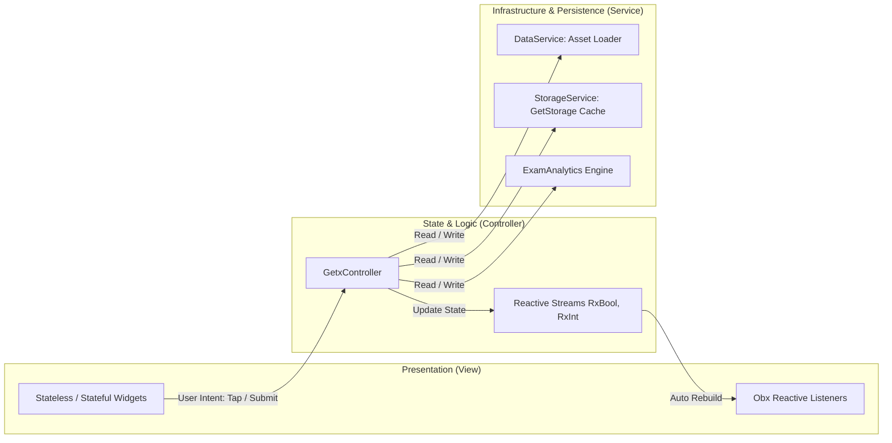

# 🏗️ System Architecture & Engineering Rationale

This document explains the architecture, design patterns, scoring logic and main engineering decisions behind **Driving Rules**, a practice app for Cambodia's driving theory exam.

> Independent project — not affiliated with or endorsed by the Ministry of Public Works and Transport (MPWT).

---

## 1. Architectural Philosophy & Constraints

The app is built around four principles:
1. **Offline-first, no backend**: All 249 practice questions and road-sign images are bundled with the app, so it works without a network connection after loading.
2. **Exam rules modelled on the real test**: The simulation follows the publicly known format of Cambodia's theory exam — 45 questions, a **38/45 pass mark**, and a **zero-tolerance rule on the right-of-way (priority) questions**.
3. **Mobile-first Khmer typography**: Layouts leave room for Khmer stacked consonants and vowels, and are tested at 1.25× text scale for overflows.
4. **One responsive codebase**: The same UI adapts from small phones (320–390 px) through tablets (768–844 px) to desktop (1050–1920 px).

---

## 2. Architecture Pattern: GetX MVC with Route Bindings

The app uses an **MVC (Model-View-Controller)** pattern with **GetX**:



### Why GetX for this project?
- **Scoped Memory Lifecycle**: Each module registers its controller using `Bindings` (e.g. `ExamBinding`, `QuizPracticeBinding`, `MistakesBinding`). When the route is removed, GetX disposes the controller, and its `onClose()` cancels any timers.
- **Narrow rebuilds**: `Obx()` wraps only the widgets that depend on a value (timer, counter, score badge), so a timer tick doesn't rebuild the whole screen.
- **Low boilerplate**: No event/state classes to write, which kept iteration fast for features like the 15-second Speed Quiz timer.
- **Trade-off**: GetX couples routing, DI and state into one library and makes controllers harder to unit-test in isolation than Riverpod or Bloc would. For a small, single-developer app this was an acceptable trade.

---

## 3. Exam Simulation State Machine & Priority Auto-Fail

The Cambodian theory test features a unique safety constraint: **five Right-of-Way (Priority) questions — questions 26–30 in this app (indexes 25–29 in code)**. Making a single mistake on these questions results in immediate disqualification, regardless of the overall score.


---

## 4. Khmer Localization & Typography

### Dual Font Strategy
- **`Kanit`**: Modern geometric sans-serif used for numeric displays, timers, and Latin headers.
- **`NotoSansKhmer`**: Variable font bundled with the app, so Khmer renders correctly even on devices with no Khmer system font.

### Handling Khmer line height
Khmer text needs noticeably more line height than Latin text because of stacked consonants (*Chhoeng*) and upper/lower vowels. Cards and option buttons therefore use:
- Adaptive padding rather than fixed heights.
- Flexible column layouts wrapping `ConstrainedBox` bounds.
- Widget tests that fail on any `RenderFlex` overflow at 390 px with **1.25× text scale**.

---

## 5. Algorithmic Models & Business Logic

### A. Exam Readiness Score (0–100%)
The readiness score is a simple heuristic (not a statistical prediction) that summarises a learner's last 5 practice exams:

$$\text{Readiness} = (R_{\text{pass}} \times 40) + (R_{\text{score}} \times 35) + (R_{\text{priority}} \times 25) - P_{\text{disqualification}}$$

Where:
- $R_{\text{pass}}$: Ratio of passed exams in sample ($\ge 38/45$).
- $R_{\text{score}}$: Cumulative correct answers over total questions ($\frac{\sum \text{Correct}}{5 \times 45}$).
- $R_{\text{priority}}$: Accuracy rate across Right-of-Way questions ($\frac{\sum \text{PriorityCorrect}}{5 \times 5}$).
- $P_{\text{disqualification}}$: A **15-point deduction** if the most recent attempt failed on a priority question.

### B. Mistakes Bank
- **Data Structure**: `Set<String>` stored in local key-value persistence.
- **Deduplication**: When an exam finishes, `ResultController` scans `ExamReviewData` and batches all failed question IDs into `StorageService.addMistakeIds()`.
- **Mastery Resolution**: When a learner answers a question correctly in the Mistakes Bank, it is removed from the set, with haptic and visual feedback.

---

## 6. Practice Certificate Image Export

When a learner scores $\ge 38/45$ with no priority mistakes, the app shows a **practice pass certificate** (clearly labelled as not an official document) that can be saved as an image:

```
[ Widget Tree: RepaintBoundary ]
       │
       ▼  (boundary.toImage with pixelRatio: 3.0)
[ ui.Image at 3× resolution      ]
       │
       ▼  (toByteData ImageByteFormat.png)
[ Uint8List: PNG Byte Stream ]
       │
       ▼  (Cross-Platform Abstraction)
┌──────────────────────┴──────────────────────┐
▼                                             ▼
Web: HTML Blob + Anchor Download      Native: Clipboard ID + Local Cache
```

- Uses a conditional platform stub (`file_download_stub.dart` vs `file_download_web.dart`) so the web download code compiles away on iOS, Android and desktop.

---

## 7. Telegram In-App Browser Gesture Bridge

Inside Telegram's in-app browser, vertical drags on the Flutter canvas can be captured by Telegram's swipe-to-close gesture.

`web/mobile-scroll.js` works around this:
- Injects Android's `allowScroll` event to lock gestures inside the canvas.
- Binds iOS's `cancellingTouch` event to prevent sheet dismissal while dragging answer lists.
- Uses passive listeners, so normal tapping and scrolling are unaffected.

---

## 8. Automated Tests

| Test Suite | File | What It Enforces |
| :--- | :--- | :--- |
| **Translation Parity** | `test/widget_test.dart` | Bidirectional key equality between `en_US` and `km_KH`. |
| **Responsive Matrix** | `test/widget_test.dart` | Multi-resolution testing at 320, 390, 768, 844, 1050, 1280, 1440, and 1920 px. |
| **Khmer Text Scaling** | `test/widget_test.dart` | 1.25x text scaling factor overflow assertions. |
| **Exam Analytics** | `test/exam_analytics_test.dart` | Mathematical correctness of readiness scores and penalty deductions. |
| **Mistakes Bank** | `test/mistakes_test.dart` | Question retrieval, batch insertion, and removal logic. |
| **Speed Quiz Loop** | `test/quiz_practice_test.dart` | 15s timer mechanics, heart depletion, and combo streaks. |
| **Property Tests** | `test/core/` | Property-based checks of question serialization and exam composition. |
