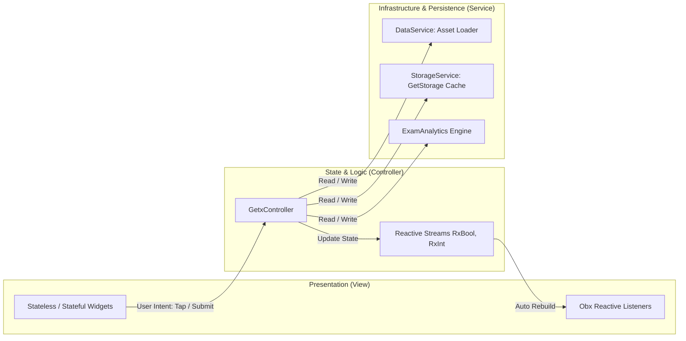
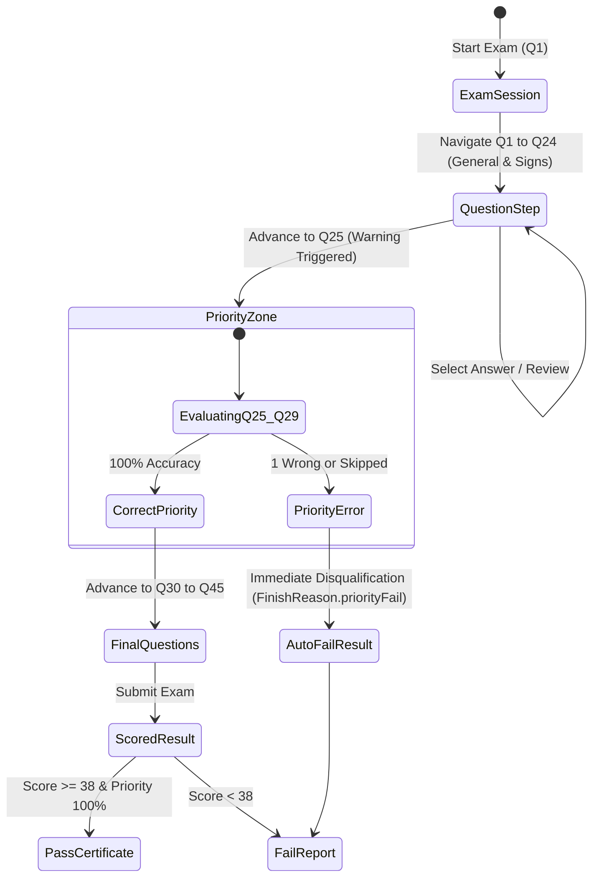

# 🏗️ System Architecture & Engineering Rationale

This document provides a comprehensive technical breakdown of the architecture, design patterns, algorithmic models, and engineering decisions implemented in the **Cambodia Driving Rules & Theory Exam Platform**.

---

## 1. Architectural Philosophy & Constraints

The application is engineered around four non-negotiable principles:
1. **Offline-First & Zero Backend Dependency**: All 249+ official theory questions, high-resolution road sign illustrations, and vector assets are bundled directly with the application.
2. **Deterministic Cambodian Licensing Engine**: Faithfully implements the official Ministry of Public Works and Transport (MPWT) driving theory test rules, including the **38/45 passing threshold** and the **zero-tolerance Right-of-Way priority auto-fail rule**.
3. **Mobile-First Khmer Script Optimization**: Engineered specifically for Khmer typography, accommodating 1.25x text scaling factors, subscript vowels, and diacritic marks without layout overflows.
4. **Universal Responsive Surface**: A unified codebase delivering pixel-perfect performance across compact mobile viewports (320px–390px), tablets (768px–844px), and desktop widescreen monitors (1050px–1920px).

---

## 2. Architecture Pattern: Reactive MVC with Scoped Route Bindings

The application uses an event-driven **MVC (Model-View-Controller)** pattern powered by **GetX**:



### Why GetX over Bloc / Riverpod for this Scope?
- **Scoped Memory Lifecycle**: Each module registers its controller using `Bindings` (e.g. `ExamBinding`, `QuizPracticeBinding`, `MistakesBinding`). When the route pops, the controller and all associated timers are instantly disposed, preventing memory leaks during intensive exam sessions.
- **Micro-Rebuild Efficiency**: Rather than rebuilding entire widget trees, `Obx()` selectively repaints only the affected counter, timer bar, or score badge.
- **Zero Boilerplate**: Avoids event/state union classes, allowing rapid iteration on game loops (e.g. 15-second countdown ticker in Speed Quiz).

---

## 3. Official Exam Simulation State Machine & Priority Auto-Fail

The Cambodian theory test features a unique safety constraint: **Questions 25 through 29 test Right-of-Way (Priority)**. Making a single mistake on these questions results in immediate disqualification, regardless of the overall score.



---

## 4. Khmer Localization & Complex Typography Engine

### Dual Font Strategy
- **`Kanit`**: Modern geometric sans-serif used for numeric displays, timers, and Latin headers.
- **`NotoSansKhmer`**: Google Fonts variable font bundled locally for Khmer script, ensuring zero "tofu" (missing glyph) errors even on devices without native Khmer firmware.

### Text-Scale Invariance
In Flutter, Khmer script naturally requires 20–25% greater vertical line-height due to stacked consonants (*Chhoeng*) and upper/lower vowels. 
All containers, cards, and option buttons utilize:
- Adaptive padding rather than fixed heights.
- Flexible column layouts wrapping `ConstrainedBox` bounds.
- Automated CI tests validating zero `RenderFlex` overflow at 390px with a **1.25x text scaling factor**.

---

## 5. Algorithmic Models & Business Logic

### A. Dynamic Exam Readiness Formula (0–100%)
The readiness score predicts a learner's probability of passing the official MPWT examination based on a weighted window of their last 5 simulations:

$$\text{Readiness} = (R_{\text{pass}} \times 40) + (R_{\text{score}} \times 35) + (R_{\text{priority}} \times 25) - P_{\text{disqualification}}$$

Where:
- $R_{\text{pass}}$: Ratio of passed exams in sample ($\ge 38/45$).
- $R_{\text{score}}$: Cumulative correct answers over total questions ($\frac{\sum \text{Correct}}{5 \times 45}$).
- $R_{\text{priority}}$: Accuracy rate across Right-of-Way questions ($\frac{\sum \text{PriorityCorrect}}{5 \times 5}$).
- $P_{\text{disqualification}}$: A **15-point safety deduction** applied if the most recent attempt suffered an instant priority disqualification.

### B. Smart Mistakes Bank (Spaced Retesting)
- **Data Structure**: `Set<String>` stored in local key-value persistence.
- **Deduplication**: When an exam finishes, `ResultController` scans `ExamReviewData` and batches all failed question IDs into `StorageService.addMistakeIds()`.
- **Mastery Resolution**: Once a learner drills and masters a question in the Mistakes Bank screen, it is purged from the set with immediate haptic and visual feedback.

---

## 6. High-DPI Credential Generation & Cross-Platform Download

When candidates achieve $\ge 38/45$ with zero priority violations, the app unlocks the **Driver Theory Pass Credential**:

```
[ Widget Tree: RepaintBoundary ]
       │
       ▼  (boundary.toImage with pixelRatio: 3.0)
[ ui.Image: 300 DPI Ultra Sharp ]
       │
       ▼  (toByteData ImageByteFormat.png)
[ Uint8List: PNG Byte Stream ]
       │
       ▼  (Cross-Platform Abstraction)
┌──────────────────────┴──────────────────────┐
▼                                             ▼
Web: HTML Blob + Anchor Download      Native: Clipboard ID + Local Cache
```

- Uses a conditional platform stub (`file_download_stub.dart` vs `file_download_web.dart`) ensuring web downloads trigger cleanly without breaking compilation on iOS, Android, or desktop targets.

---

## 7. Telegram In-App Browser Gesture Bridge

When embedded inside Telegram's webview, Flutter web's CanvasKit renderer often conflicts with Telegram's pull-to-dismiss sheet gesture. 

`web/mobile-scroll.js` bridges native Telegram events:
- Injects Android's `allowScroll` event to lock gestures inside the canvas.
- Binds iOS's `cancellingTouch` event to prevent sheet dismissal while dragging answer lists.
- Completely passive listeners that preserve standard selection, tapping, and pinch-to-zoom.

---

## 8. Quality Assurance & Automated Testing Matrix

| Test Suite | File | What It Enforces |
| :--- | :--- | :--- |
| **Translation Parity** | `test/widget_test.dart` | Bidirectional key equality between `en_US` and `km_KH`. |
| **Responsive Matrix** | `test/widget_test.dart` | Multi-resolution testing at 320, 390, 768, 844, 1050, 1280, 1440, and 1920 px. |
| **Khmer Text Scaling** | `test/widget_test.dart` | 1.25x text scaling factor overflow assertions. |
| **Exam Analytics** | `test/exam_analytics_test.dart` | Mathematical correctness of readiness scores and penalty deductions. |
| **Mistakes Bank** | `test/mistakes_test.dart` | Question retrieval, batch insertion, and removal logic. |
| **Speed Quiz Loop** | `test/quiz_practice_test.dart` | 15s timer mechanics, heart depletion, and combo streaks. |
| **Property Tests** | `test/core/` | Question model serialization invariants and partitioning guarantees. |
