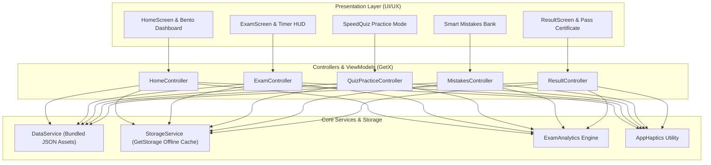

# 🚗 Cambodia Driving Rules & Theory Exam Platform

<p align="center">
  <a href="https://github.com/danishsary8/driving-rules/actions"></a>
  <a href="https://flutter.dev"></a>
  <a href="https://dart.dev"></a>
  
  
  
</p>

An enterprise-grade, mobile-first driving theory exam simulation and learning platform for Cambodia. Built with **Flutter**, **GetX**, and an **Offline-First Reactive Architecture**.

---

## 🌟 Key Engineering & Product Features

### 1. 🛡️ Official Exam Simulation (Strict Auto-Fail Priority Rules)
- **45 Questions · 45-Minute Official Countdown**: Conforms to the standard Cambodian driving theory curriculum.
- **Strict Passing Threshold (38 / 45)**: Requires an 84% benchmark to pass.
- **Critical Priority Auto-Fail Rule (Q25–Q29)**: Questions 25 through 29 test Right-of-Way. Zero errors allowed—a single incorrect or skipped answer triggers an immediate auto-fail and routes directly to the detailed disqualification report.
- **In-Exam Reminders**: Clickable `[ ℹ️ Exam Rules ]` reminder pill and high-visibility priority warning banners keep learners informed throughout the test.

### 2. 🏆 Official Digital Pass Certificate & Shareable Credential
- Unlocked when candidates score $\ge 38/45$ with zero priority violations.
- Renders an official-style completion credential featuring a unique verification Serial ID, issue date, score breakdown, and security clearance seal.
- One-tap credential ID copy and sharing actions.

### 3. 🧠 Smart Mistakes Bank (Weak-Area Smart Retest)
- Automatically captures questions missed across **Real Exams**, **Speed Quizzes**, or **Study Sessions**.
- Dedicated drill mode allowing learners to train specifically on their personal blind spots.
- Once answered correctly, questions graduate and clear from the bank with rewarding tactile feedback.

### 4. ⚡ Gamified Speed Quiz Practice Challenge
- **15-Second Timer per Question**: Fast-paced training for quick roadside decision-making.
- **3 Hearts / Lives System**: Keeps players engaged while reinforcing accuracy.
- **Combo Multipliers & Speed XP Bonuses**: Rewards rapid, correct streaks with dynamic score multipliers and pulse animations.

### 5. 📊 Exam Readiness Score Engine (0–100%)
- Predictive readiness score derived from the candidate's last 5 simulation attempts:
  $$\text{Readiness} = 40\% \times \text{PassRate} + 35\% \times \text{ScoreRate} + 25\% \times \text{PriorityAccuracy} - \text{DisqualificationPenalty}$$
- 4 qualitative readiness tiers (`Exam Ready`, `Moderate Progress`, `Needs Practice`, `Not Tested Yet`) paired with personalized coaching recommendations.
- Category mastery breakdown for all 5 domains (*General, Signs, Priority, Technique, Emergency*).

### 6. 📳 Tactile Haptic Vibration Feedback (`AppHaptics`)
- Physics-based tactile sensation across option selections, warning zone transitions, speed combos, and error states.
- Defensively engineered for cross-platform stability (Web, iOS, Android, Desktop).

### 7. 🇰🇭 Full Bilingual Localization with Parity Enforcement
- Complete English (`en_US`) and Khmer (`km_KH`) support with custom typography (`Kanit`, `NotoSansKhmer`).
- Automated CI test enforces 100% key and translation parity.

### 8. 📱 Responsive Adaptive UI (320px to 1920px)
- Zero RenderFlex overflows across all device form factors:
  - **Compact Phones** (320px–390px with 1.25x Khmer text scaling).
  - **Tablets & Foldables** (768px–844px).
  - **Desktop & Widescreen Displays** (1050px–1920px Bento Grid layout).

---

## 🏛️ Architecture Overview

The application follows clean separation of concerns using reactive state management:



---

## 🧪 Testing & Verification

The project enforces automated test coverage across business logic, models, controllers, and responsive layouts:

```powershell
# Run static analysis (0 warnings)
flutter analyze

# Run all 37+ unit, property-based, and widget tests
flutter test

# Run Telegram / Mobile in-app browser gesture suite
node --test test/web/mobile_scroll_test.cjs
```

### Test Suites Included:
- `test/widget_test.dart`: Multi-device responsive flows (320px to 1920px), Khmer font scaling, and translation parity.
- `test/exam_analytics_test.dart`: Readiness algorithm weights, priority disqualification penalties, and category mastery.
- `test/mistakes_test.dart`: Smart Mistakes Bank persistence and Driver Certificate rendering.
- `test/quiz_practice_test.dart`: Speed Quiz timer mechanics, lives decrement, and combo multipliers.
- `test/core/`: Property-based serialization round-trips and exam composition guarantees.

---

## 🚀 Getting Started

### Prerequisites
- [Flutter SDK](https://flutter.dev/docs/get-started/install) (3.19+ recommended)
- Dart SDK 3.x

### Installation
```bash
# Clone the repository
git clone https://github.com/danishsary8/driving-rules.git
cd driving-rules

# Install dependencies
flutter pub get

# Launch on Chrome / Edge
flutter run -d chrome
```

---

## 📄 License
This project is licensed under the MIT License - see the [LICENSE](LICENSE) file for details.
