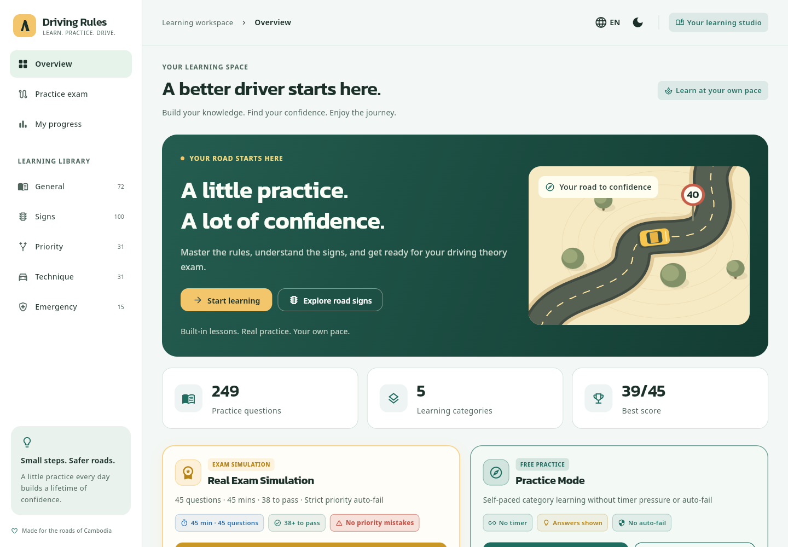
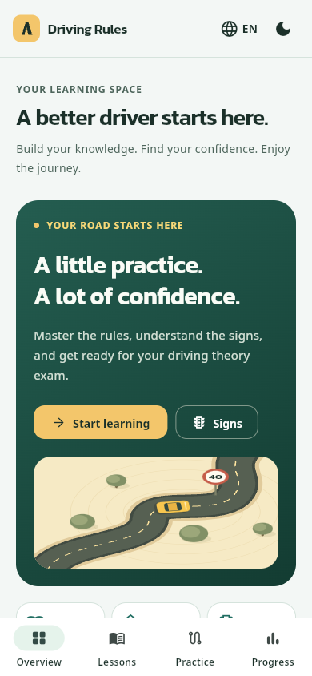
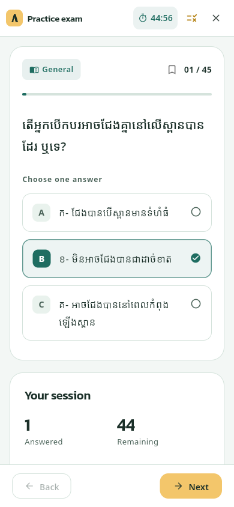
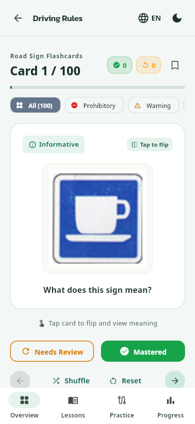
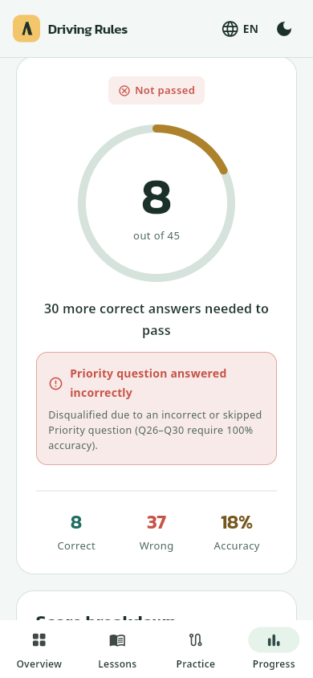

# 🚗 Driving Rules — Cambodia Theory Exam Practice

<p align="center">
  <a href="https://github.com/danishsary8/driving-rules/actions/workflows/ci.yml"></a>
  
  
  
  
</p>

<p align="center">
  A bilingual (English / Khmer), offline-first Flutter app for learning Cambodia's road rules<br/>
  and practising the 45-question driving theory exam.
</p>

<p align="center">
  <b><a href="https://danishsary8.github.io/driving-rules/">▶ Live web demo</a></b>
</p>

<p align="center">
  
</p>
<p align="center">
  
  
  
  
</p>

> **Disclaimer:** This is an independent practice project. It is not affiliated with or endorsed by
> the Cambodian Ministry of Public Works and Transport, and the in-app pass certificate is a
> motivational practice badge — not an official document.

---

## ✨ Features

| | Feature | What it does |
|---|---|---|
| 📝 | **Exam simulation** | 45 questions, 45-minute timer, pass at 38/45. Priority (right-of-way) questions 26–30 are zero-tolerance: one mistake fails the exam. |
| 💾 | **Session recovery** | An in-progress exam is saved locally and can be resumed after a refresh or app restart. |
| 📚 | **Lessons by category** | 249 questions across 5 categories: General, Signs, Priority, Technique, Emergency. |
| 🪧 | **Road-sign flashcards** | Signs grouped by type (warning, prohibition, mandatory, information) with 3D flip cards. |
| ⚡ | **Speed quiz** | 15 seconds per question, 3 lives, combo multipliers. |
| 🧠 | **Mistakes bank** | Every wrong answer is collected; answer it correctly to clear it. Bookmarks for questions you want to revisit. |
| 📊 | **Progress & readiness** | Readiness score (0–100%) from your last 5 exams, per-category mastery, attempt history. |
| 🔍 | **Answer review** | Go through each exam question with your answer and the correct one. |
| 🌐 | **English / Khmer** | Full translation with bundled Kanit + Noto Sans Khmer fonts; a test enforces key parity between languages. In Khmer, small text is enlarged and letter-spacing is relaxed so stacked vowels and subscripts stay readable. |
| 🌗 | **Light / dark theme** | Persisted preference. |
| 📱 | **Responsive** | Bottom navigation on phones, sidebar dashboard on desktop; tested from 320 px to 1920 px wide. |
| ⌨️ | **Keyboard support** | Answer and navigate exams from the keyboard on desktop/web. |

Everything runs on-device — no backend, no account, no network calls after the app loads.

---

## 🛠 Tech stack

- **Flutter 3 / Dart 3.9**
- **GetX** — state management, routing, dependency bindings, translations
- **GetStorage** — local persistence (results, mistakes, bookmarks, settings, exam session)
- **flutter_animate**, **shimmer**, **percent_indicator** — animation and UI polish
- **GitHub Actions** — analyze + test on every push/PR, auto-deploy web build to GitHub Pages

---

## 🏗 Project structure

```
lib/
├── main.dart              # App entry: storage init, theme, locale, routes
├── app/
│   ├── bindings/          # GetX dependency bindings
│   ├── routes/            # Route table
│   ├── themes/            # Light / dark theme
│   └── translations/      # en_US and km_KH strings
├── core/
│   ├── models/            # Question, ExamResult, analytics, sign categories
│   ├── services/          # DataService (bundled JSON), StorageService (GetStorage)
│   └── utils/             # Exam builder & scorer (pure logic)
├── modules/               # One folder per screen: controller + screen + widgets
│   ├── home/  study/  flashcards/  exam/  quiz_practice/
│   └── mistakes/  result/  review/  progress/  splash/
└── shared/widgets/        # App shell, navigation, reusable components
driving_rules_data/        # Question JSON + road-sign images (bundled assets)
test/                      # Unit, property-based and widget tests
```

More detail on design decisions is in **[ARCHITECTURE.md](ARCHITECTURE.md)**.

---

## 🚀 Getting started

**Requirements:** Flutter SDK (stable, with Dart ≥ 3.9).

```bash
git clone https://github.com/danishsary8/driving-rules.git
```

```bash
cd driving-rules && flutter pub get
```

```bash
flutter run -d chrome
```

Build a release web bundle:

```bash
flutter build web --release
```

---

## 🧪 Testing

```bash
flutter analyze
```

```bash
flutter test
```

```bash
node --test test/web/mobile_scroll_test.cjs
```

The suite covers:

- **Exam logic** — exam composition, scoring, the priority auto-fail rule (`test/core/`)
- **Models** — property-based JSON round-trips for questions and results
- **Analytics** — readiness score weights and category mastery
- **Features** — speed quiz timer/lives/combos, mistakes bank, bookmarks, flashcards, session recovery
- **UI** — responsive layouts from 320 px to 1920 px, Khmer text scaling, translation parity
- **Web** — scroll behaviour inside in-app browsers (e.g. Telegram)

CI runs analyze and tests on every push and pull request to `main`.

---

## 📄 License

[MIT](LICENSE)
