<p align="center">
  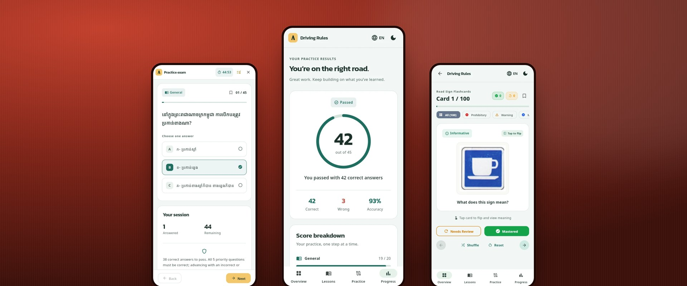
</p>

<h1 align="center">Driving Rules</h1>

<p align="center">
  <b>Pass Cambodia's driving theory exam.</b><br/>
  Learn the road rules in Khmer or English, then take a practice exam that works like the real one.
</p>

<p align="center">
  <a href="https://danishsary8.github.io/driving-rules/"></a>
</p>

<p align="center">
  <a href="https://github.com/danishsary8/driving-rules/actions/workflows/ci.yml"></a>
  
  
  
  
  
</p>

<table align="center">
  <tr>
    <td align="center"><h3>249</h3>practice questions</td>
    <td align="center"><h3>100</h3>road-sign questions</td>
    <td align="center"><h3>45 min</h3>timed exam, 38 to pass</td>
    <td align="center"><h3>333</h3>strings in Khmer</td>
  </tr>
</table>

---

## Why it exists

Learners prepare for the theory exam from printed question lists. There's no easy way to
practise under real exam rules, and nothing shows which questions you keep getting wrong.

**Driving Rules** is a phone app that works offline: lessons for every question, road-sign
flashcards, a timed exam with the real pass rules, and a mistakes bank that brings back what
you got wrong.

> **Not official.** This is an independent practice project, not affiliated with or endorsed
> by the Ministry of Public Works and Transport. The in-app pass certificate is a practice
> badge, not an official document.

---

## 📲 Install on your phone

Open the [live demo](https://danishsary8.github.io/driving-rules/) on your phone and add it
to your home screen. It opens full screen like an app and, **after this first visit, works
with no internet**.

| Android (Chrome) | iPhone (Safari) |
|---|---|
| Tap **⋮** → **Install app** (or **Add to Home screen**) | Tap **Share** → **Add to Home Screen** |

Your progress stays on the phone. On iPhone, the home-screen app keeps its own progress,
separate from Safari.

---

## 📚 Learn

<table>
  <tr>
    <td align="center" width="25%">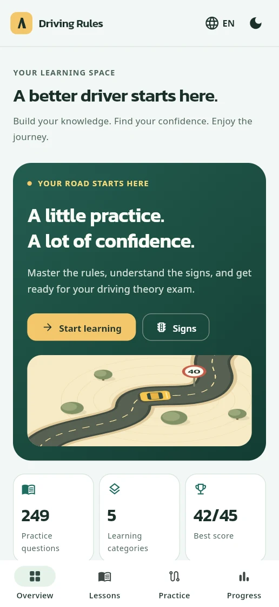</td>
    <td align="center" width="25%">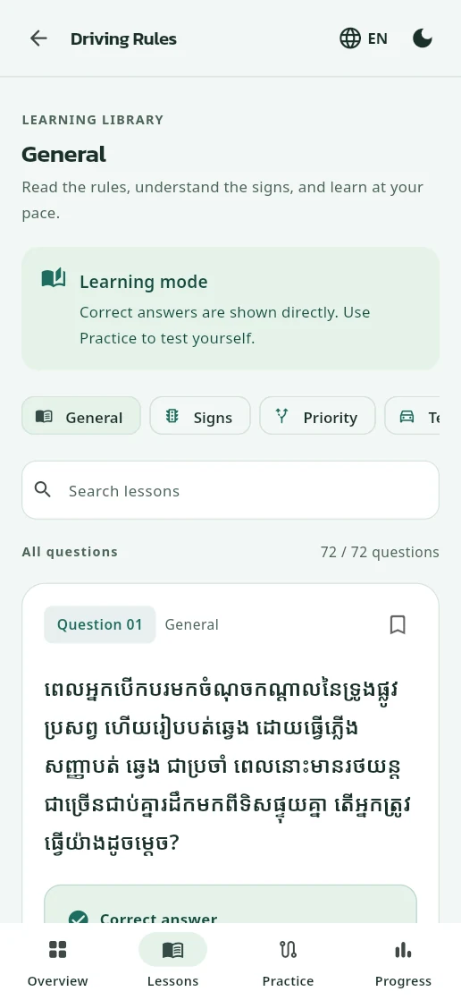</td>
    <td align="center" width="25%">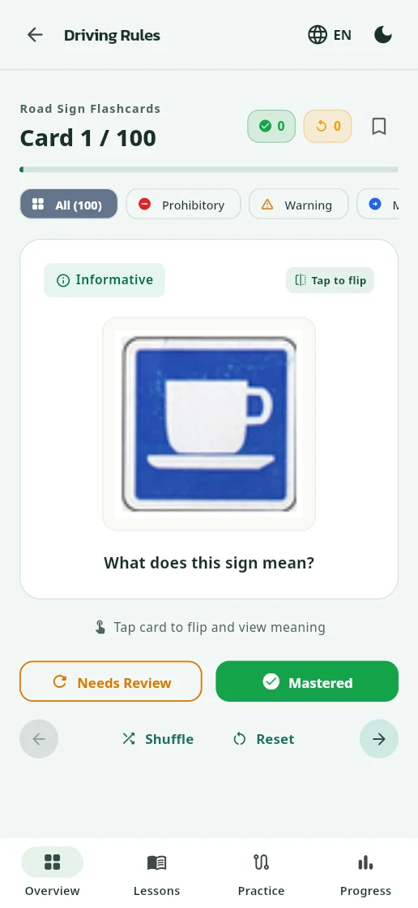</td>
    <td align="center" width="25%">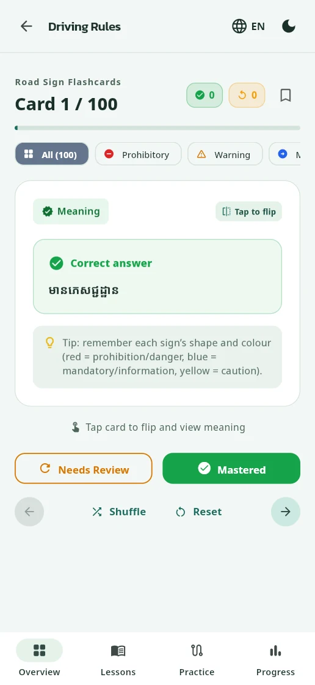</td>
  </tr>
  <tr>
    <td align="center"><b>Home</b><br/><sub>Start learning, open the signs, or begin an exam</sub></td>
    <td align="center"><b>Lessons</b><br/><sub>Every question with its correct answer, in five topics</sub></td>
    <td align="center"><b>Road-sign flashcards</b><br/><sub>100 signs, filtered by type</sub></td>
    <td align="center"><b>Flip to learn</b><br/><sub>See the meaning, then mark it mastered or to review</sub></td>
  </tr>
</table>

## 📝 Take the practice exam

It follows the real format: **45 questions in 45 minutes, 38 correct to pass**.
Questions **26–30** test right of way, and a single wrong answer there ends the exam.

<table>
  <tr>
    <td align="center" width="25%">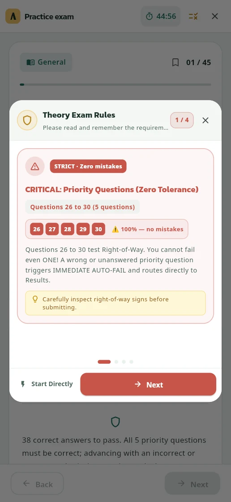</td>
    <td align="center" width="25%">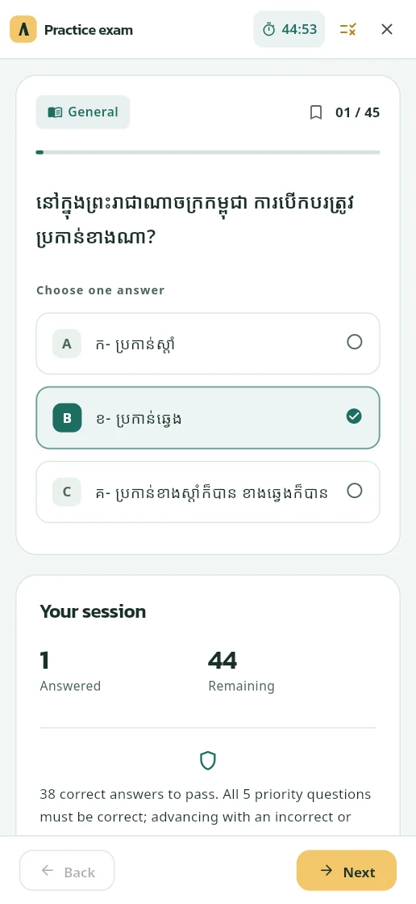</td>
    <td align="center" width="25%">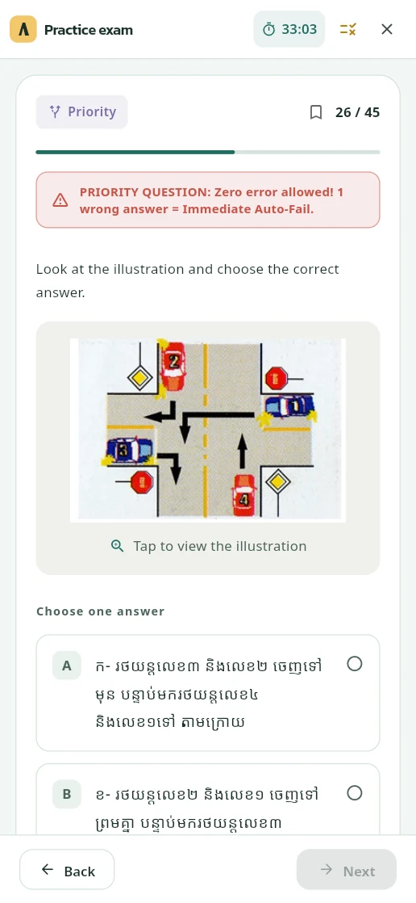</td>
    <td align="center" width="25%">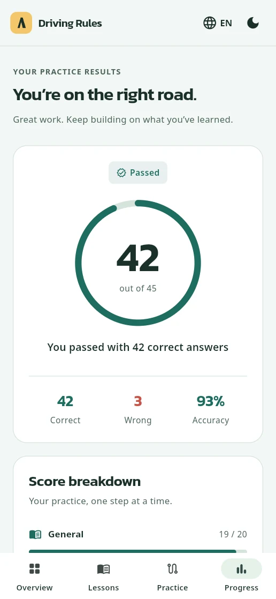</td>
  </tr>
  <tr>
    <td align="center"><b>The rules first</b><br/><sub>Four short slides before the timer starts</sub></td>
    <td align="center"><b>One question at a time</b><br/><sub>Progress is saved if the page reloads</sub></td>
    <td align="center"><b>Priority questions</b><br/><sub>Zero mistakes allowed on 26–30</sub></td>
    <td align="center"><b>Result</b><br/><sub>Pass or not, and how close you were</sub></td>
  </tr>
  <tr>
    <td align="center">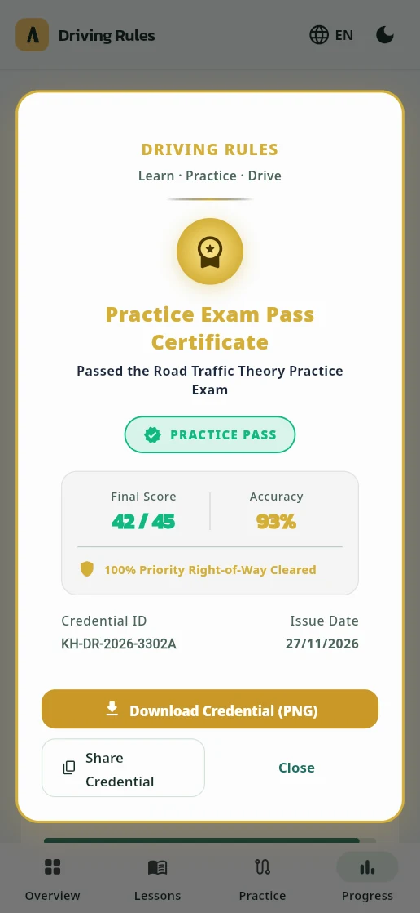</td>
    <td align="center">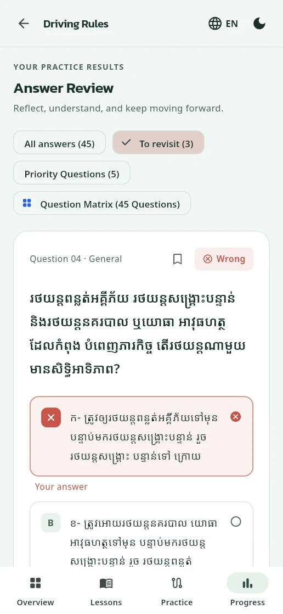</td>
    <td align="center">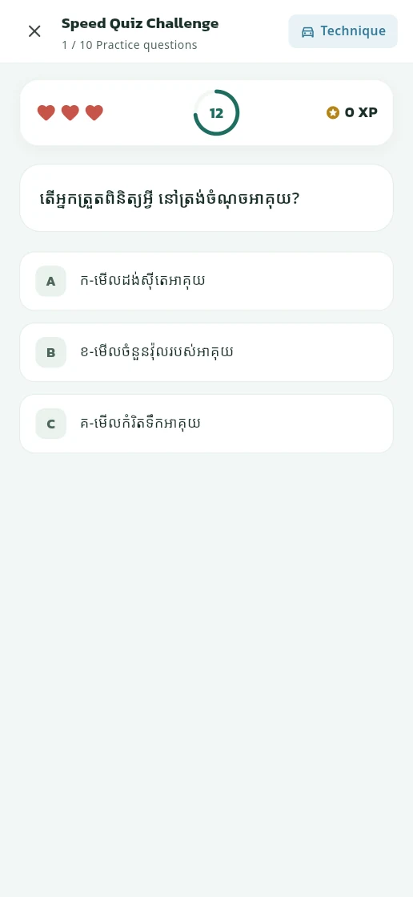</td>
    <td align="center">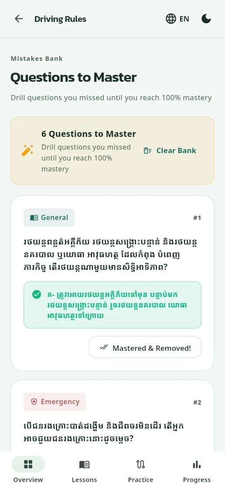</td>
  </tr>
  <tr>
    <td align="center"><b>Practice certificate</b><br/><sub>Download or share a pass</sub></td>
    <td align="center"><b>Answer review</b><br/><sub>Filter to the questions you got wrong</sub></td>
    <td align="center"><b>Speed quiz</b><br/><sub>10 questions, 15 seconds each, 3 lives</sub></td>
    <td align="center"><b>Mistakes bank</b><br/><sub>Wrong answers stay until you get them right</sub></td>
  </tr>
</table>

## 📈 Track your progress

<table>
  <tr>
    <td width="34%" align="center">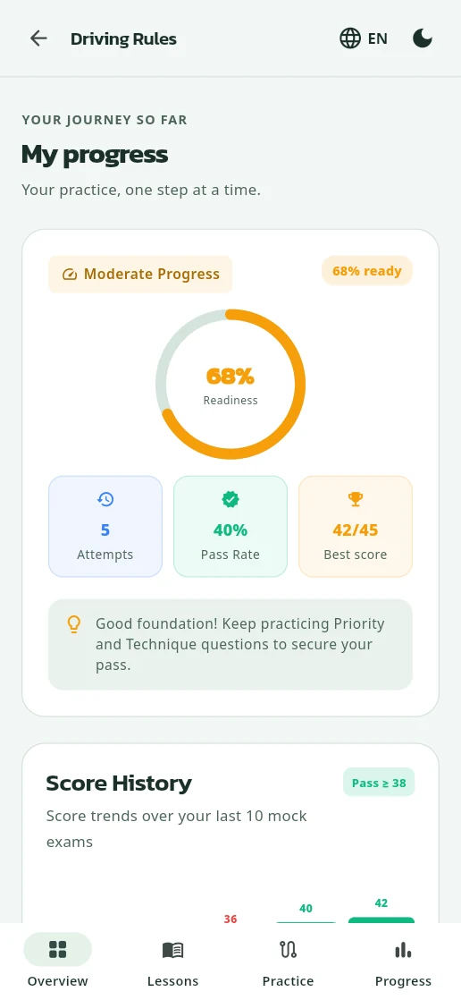</td>
    <td width="66%">
      <h3>Know when you're ready</h3>
      <p>A <b>readiness score</b> (0–100%) is worked out from your last five exams: how often you
      passed, your average score, and how you did on the priority questions.</p>
      <p>Below it: every exam score as a chart, mastery for each of the five topics, and quick
      links back to your mistakes, bookmarks and flashcards.</p>
    </td>
  </tr>
</table>

## 🇰🇭 Made for Khmer readers

<table>
  <tr>
    <td width="66%">
      <h3>Every screen in Khmer and English</h3>
      <p>Switch language with one tap. All 333 interface strings exist in both languages, and a
      test fails the build if one is missing.</p>
      <p>Khmer stacks consonants and vowels above and below the line, so in Khmer mode small
      text is enlarged and letter-spacing is relaxed. Khmer stays readable even on a 320 px phone.
      Fonts (Kanit and Noto Sans Khmer) are bundled, so nothing depends on the network.</p>
    </td>
    <td width="34%" align="center">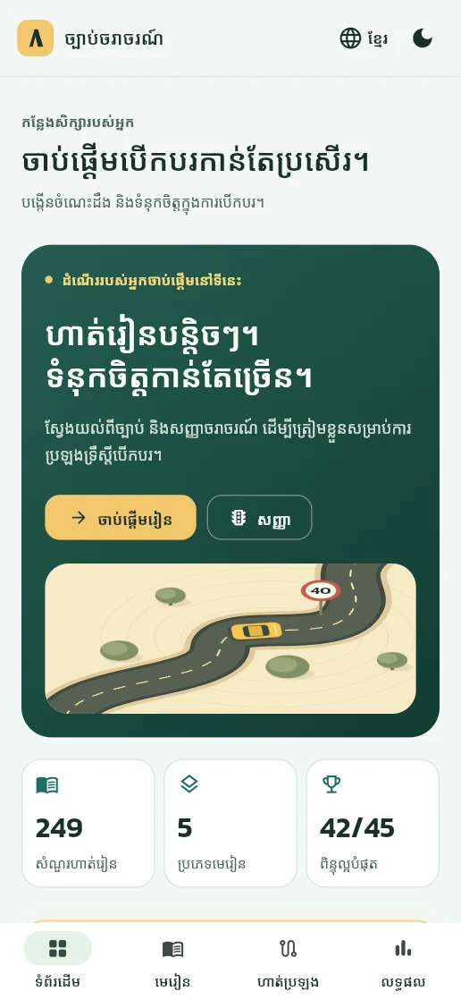</td>
  </tr>
</table>

---

## ✨ Features at a glance

| | |
|---|---|
| 📝 **Practice exam** | 45 questions, 45-minute timer, 38 to pass, zero-mistake priority questions |
| 💾 **Resume after refresh** | An exam in progress is saved on the device and can be resumed |
| 📚 **Lessons** | All 249 questions in 5 topics: General, Signs, Priority, Technique, Emergency |
| 🪧 **Flashcards** | 100 road signs grouped as prohibitory, warning, mandatory and information |
| ⚡ **Speed quiz** | 10 questions, 15 seconds each, 3 lives, combo bonuses |
| 🧠 **Mistakes & bookmarks** | Every wrong answer is collected; save any question to come back to |
| 📈 **Progress** | Readiness score, score history and per-topic mastery |
| 🌐 **English / ខ្មែរ** | Full translation with Khmer readability tuning |
| 🌗 **Light & dark** | Your choice is remembered |
| 📱 **Responsive** | Phone first, with a sidebar layout on tablets and desktop |
| 📴 **Offline** | Install it to your home screen and it works with no internet; no account, no server |

---

## 🛠 Built with

<p>
  
  
  
  
  
</p>

- **Flutter 3 / Dart 3.9**, one codebase for web, Android and iOS
- **GetX** for state, routing, dependency bindings and translations
- **GetStorage** for results, mistakes, bookmarks, settings and the saved exam
- **flutter_animate**, **shimmer**, **percent_indicator** for motion and polish
- **GitHub Actions** runs analysis and tests on every push and pull request, then deploys
  the web build to GitHub Pages

<details>
<summary><b>Project structure</b></summary>

```
lib/
├── main.dart              # App entry: storage, theme, locale, routes
├── app/
│   ├── bindings/          # GetX dependency bindings
│   ├── routes/            # Route table
│   ├── themes/            # Light/dark theme, Khmer typography
│   └── translations/      # en_US and km_KH strings
├── core/
│   ├── models/            # Question, ExamResult, analytics, sign categories
│   ├── services/          # DataService (bundled JSON), StorageService (GetStorage)
│   └── utils/             # Exam builder and scorer (pure logic)
├── modules/               # One folder per screen: controller + screen + widgets
│   ├── home/  study/  flashcards/  exam/  quiz_practice/
│   └── mistakes/  result/  review/  progress/  splash/
└── shared/widgets/        # App shell, navigation, reusable components
driving_rules_data/        # Question JSON + road-sign images (bundled)
test/                      # Unit, property-based and widget tests
```

Design decisions are explained in **[ARCHITECTURE.md](ARCHITECTURE.md)**.

</details>

---

## 🚀 Run it locally

You need the Flutter SDK (stable, Dart 3.9 or newer).

```bash
git clone https://github.com/danishsary8/driving-rules.git
```

```bash
cd driving-rules && flutter pub get
```

```bash
flutter run -d chrome
```

Build the web version:

```bash
flutter build web --release
```

## 🧪 Tests

```bash
flutter analyze
```

```bash
flutter test
```

```bash
node --test test/web/mobile_scroll_test.cjs
```

71 automated tests cover the exam rules and scoring, data loading and question IDs, the
readiness score, the speed quiz, mistakes and flashcards, Khmer typography, screens opened by
direct link or refresh, and layouts from 320 px to 1920 px wide (including Khmer at 1.25× text
size). The Node test covers scrolling inside in-app browsers such as Telegram.

---

<p align="center">
  <sub>Made for the roads of Cambodia · <a href="LICENSE">MIT License</a></sub>
</p>
