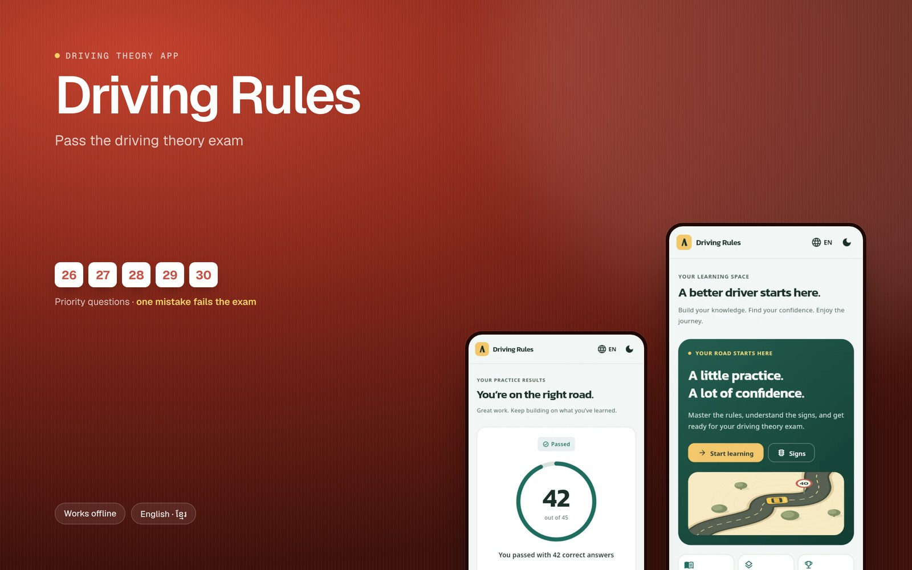
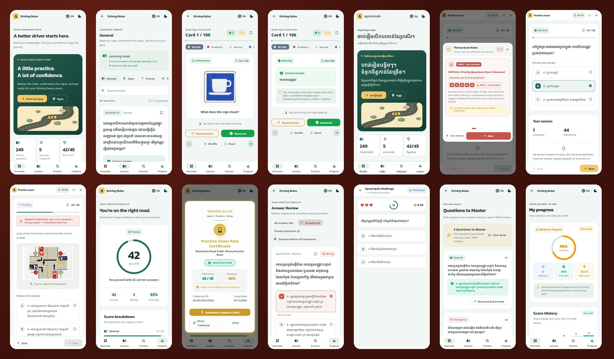

# Portfolio kit: Driving Rules

Everything needed to add this project to the portfolio (Danish_portfolio), in the same
shape as the Bookly case study. Captured from the real app (a local release web build)
with demo data on 27 Nov 2026.

This is a Flutter app made for phones, so **every screen is a phone shot only** (no laptop),
and the covers show phones.

## What's here

| Path | What it is | Size |
| --- | --- | --- |
| `cover/card.webp` | Project card cover (16:10), with title, one line and language tag | 3200×2000 |
| `cover/banner.webp` | Wide banner for the top of the case study (2.4:1), no title | 3840×1600 |
| `cover/*.jpg` | Same covers at half size, for LinkedIn, README or slides | 1600×1000, 1920×800 |
| `cover/cover.source.html` | Source of both covers, if a change is ever needed | |
| `screens/m-*.webp` | 14 phone screens | 516×1118 |
| `driving.portfolio.ts` | Ready-to-paste portfolio entry: pitch, facts, problem, what I built, screens, numbers, future plan | |
| `overview.jpg` | All 14 screens on one page, for a quick look | 1600×936 |

Phone shots use the same size as the Bookly and Diabetes phone screenshots
(430×932 at 1.2×, saved 516×1118), so the case studies line up.

## The story (also in `driving.portfolio.ts`)

**Pitch.** Learn Cambodia's road rules in Khmer or English, then take a practice exam that
works like the real one: 45 questions, 45 minutes, and no mistakes allowed on right of way.

**The problem.** Learners prepare for the theory exam from printed question lists. There's no
easy way to practise under real exam rules, and nothing shows which questions you keep
getting wrong.

**What I built.** A phone app that works offline: lessons for every question, road-sign
flashcards, a timed exam with the real pass rules, and a mistakes bank that brings back what
you got wrong.

**Numbers** (checked against the code): 249 practice questions · 100 road-sign questions ·
333 strings in both English and Khmer · 71 automated tests passing.

**Future development plan**
- Publish on Google Play and the App Store
- Have a driving instructor check every answer's explanation
- Read questions aloud in Khmer
- Bring mistakes back on a schedule (spaced repetition)

**Facts row:** Solo, Flutter · Phone-first, works offline · English · ខ្មែរ · 45 questions, 38 to pass.

## Screens

| Group | Screen | File |
| --- | --- | --- |
| Learn | Home | `m-home` |
| Learn | Lessons: every question with its answer | `m-lessons` |
| Learn | Road-sign flashcards | `m-flashcards` |
| Learn | Card back: the sign's meaning | `m-flashcard-back` |
| Learn | Home in Khmer | `m-home-km` |
| Exam | Exam rules (priority rule slide) | `m-exam-rules` |
| Exam | Exam question with a chosen answer | `m-exam` |
| Exam | Priority question 26 with its warning | `m-priority` |
| Exam | Result: passed with 42 / 45 | `m-result` |
| Exam | Practice certificate | `m-certificate` |
| Exam | Answer review, filtered to wrong answers | `m-review` |
| Practice | Speed quiz | `m-speed-quiz` |
| Practice | Mistakes bank | `m-mistakes` |
| Practice | Progress and readiness | `m-progress` |

## Adding it to the portfolio

1. Copy `screens/*.webp` into `src/assets/projects/driving/` and the covers next to the other covers.
2. Add the `driving` image lookup to `src/lib/assets.ts` (the exact lines are at the top of
   `driving.portfolio.ts`).
3. In `src/content/portfolio.ts`, replace the current `driving` entry with the one in
   `driving.portfolio.ts`, and map each screen name through the lookup.
4. **Phone-only screens:** in `CaseStudy.screens`, make `desktop` optional
   (`desktop?: string`) and, when it's missing, show the phone on its own instead of the
   laptop + phone pair. Widen `group` to include `"Learn" | "Exam" | "Practice"`.
5. The "How I built it" blocks (`steps`, `practices`, `challenges`, `lessons`) are empty on
   purpose. Hide a block when its list is empty, so no empty headings show.
6. `ProjectCover` draws real screenshots only for `id === "bookly"`; `driving` currently
   shows a drawn preview. Either use `cover/card.webp` as the driving cover image, or add a
   phones-only branch for `driving` with `m-home` and `m-result`. Keep the existing
   `driving` theme (the cover uses its exact colours).
7. `githubUrl` now points at the repo (`danishsary8/driving-rules`) instead of the profile.

## Notes

- **Demo data only.** The app has no accounts and no server: questions are bundled with the
  app, and progress lives in the browser's local storage. The exam history, saved mistakes,
  bookmarks and the 42 / 45 pass were seeded for the screenshots; the exam answers came from
  the app's own question files and the app scored them itself.
- No demo banners or floating chat buttons exist in this app, so nothing had to be hidden.
  Every shot waited for animations (count-ups, confetti, entrances) to finish.
- **Role.** The repo history shows you wrote the app (the first 14 commits, from the first
  build on 6 Oct 2026 through the UI overhaul). Later commits — docs, bug fixes, refactors and
  tests — were made with an AI coding assistant. The entry says "Solo, Flutter" and the
  summary says this plainly; change it if you'd describe it differently.
- **Live URL.** The entry keeps the Netlify URL your portfolio already uses. The README of
  the repo links the GitHub Pages build. I couldn't open either from the capture machine, so
  check that the one you keep is live.
- While capturing, three real bugs turned up and were fixed on the same branch first (so the
  screens are honest): question ids collided across categories (wrong questions on resume,
  in mistakes and bookmarks), saved mistakes rendered as grey error boxes, and two dialogs
  had the wrong button labels. These fixes are not on `main` yet.
